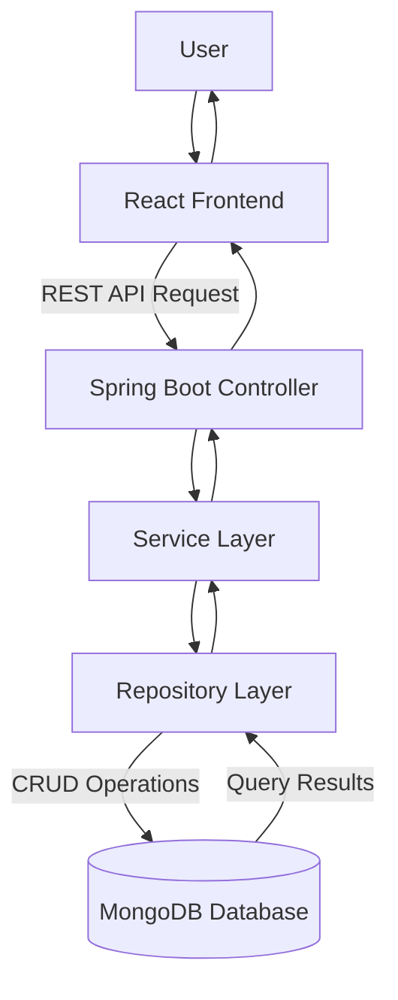
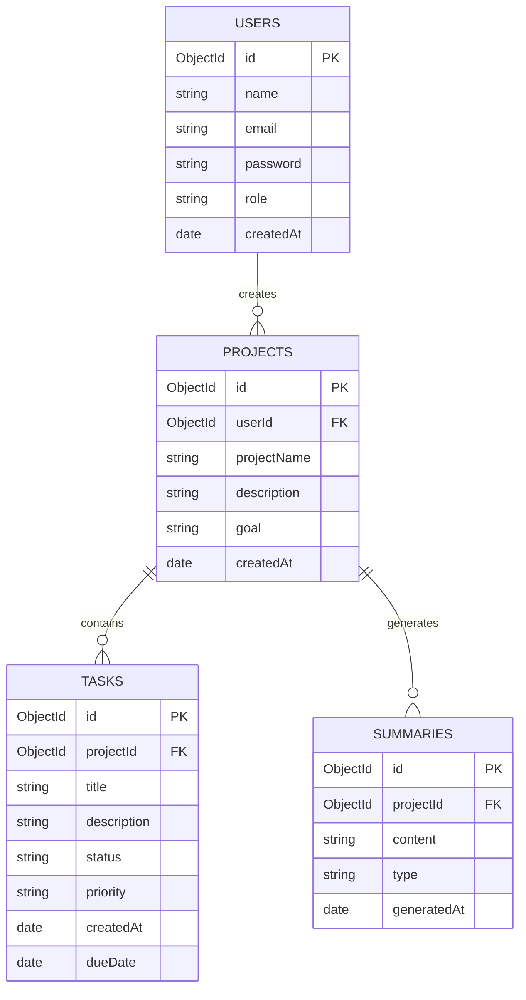
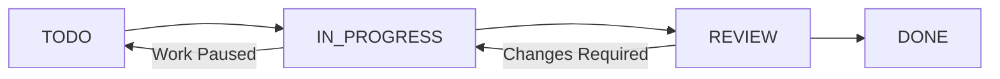

# Database Design Document – AI-Powered Kanban Planner

## 1. Introduction

### 1.1 Purpose

This document describes the database structure and data organization of the AI-Powered Kanban Planner.

It defines the MongoDB database, collections, document structures, relationships, validation rules, and indexing strategy.

### 1.2 Database Overview

The AI-Powered Kanban Planner uses MongoDB as its primary NoSQL database.

MongoDB stores application data in flexible JSON-like documents called BSON documents.

The database is designed to store:

- User information
- Project details
- Task information
- AI-generated summaries

### 1.3 Database Technology

| Property | Details |
|---|---|
| Database | MongoDB |
| Database Type | NoSQL |
| Data Format | BSON |
| Backend Integration | Spring Data MongoDB |
| Database Name | kanban_db |
| Local Connection | mongodb://localhost:27017/kanban_db |
| Cloud Database | MongoDB Atlas (planned) |

---

## 2. Database Architecture

### 2.1 Database Architecture Overview

The Spring Boot backend communicates with MongoDB through the Repository Layer.

The Service Layer contains business logic, while the Repository Layer performs database operations.

### 2.2 Database Architecture Diagram



### 2.3 Database Name

Database Name: `kanban_db`

The application uses this database to store all project-related information.

---

## 3. Collection Design

MongoDB organizes data using collections.

The proposed database contains the following collections:

| Collection | Purpose |
|---|---|
| users | Stores user account information |
| projects | Stores project details and goals |
| tasks | Stores project tasks and their statuses |
| summaries | Stores AI-generated summaries |

### 3.1 Users Collection

**Purpose:**

Stores user registration and authentication information.

**Fields:**

| Field | Data Type | Description |
|---|---|---|
| _id | ObjectId | Unique user identifier |
| name | String | User's full name |
| email | String | User's email address |
| password | String | Hashed password |
| role | String | User role |
| createdAt | Date | Account creation date |
| updatedAt | Date | Last update date |

**Example Document:**

```json
{
  "_id": "USER_ID",
  "name": "John",
  "email": "john@example.com",
  "password": "HASHED_PASSWORD",
  "role": "USER",
  "createdAt": "2026-11-02T10:00:00",
  "updatedAt": "2026-11-02T10:00:00"
}
```

Note: The example ID is illustrative. MongoDB normally generates an ObjectId for `_id`. Passwords must be stored as secure hashes, never as plain text.

### 3.2 Projects Collection

**Purpose:**

Stores project information and the goals entered by users.

**Fields:**

| Field | Data Type | Description |
|---|---|---|
| _id | ObjectId | Unique project identifier |
| userId | ObjectId / String | Reference to the project owner |
| projectName | String | Name of the project |
| description | String | Project description |
| goal | String | Main project goal |
| createdAt | Date | Project creation date |
| updatedAt | Date | Last update date |

**Example Document:**

```json
{
  "_id": "PROJECT_ID",
  "userId": "USER_ID",
  "projectName": "E-commerce Website",
  "description": "Develop an online shopping platform",
  "goal": "Build an E-commerce Website",
  "createdAt": "2026-11-02T10:00:00",
  "updatedAt": "2026-11-02T10:00:00"
}
```

### 3.3 Tasks Collection

**Purpose:**

Stores tasks generated by AI or manually created by users.

**Fields:**

| Field | Data Type | Description |
|---|---|---|
| _id | ObjectId | Unique task identifier |
| projectId | ObjectId / String | Reference to the project |
| title | String | Task title |
| description | String | Task description |
| status | String | Current task status |
| priority | String | Task priority |
| createdAt | Date | Task creation date |
| updatedAt | Date | Last update date |
| dueDate | Date | Task deadline |

**Example Document:**

```json
{
  "_id": "TASK_ID",
  "projectId": "PROJECT_ID",
  "title": "Create Login Page",
  "description": "Develop the user login interface",
  "status": "TODO",
  "priority": "HIGH",
  "createdAt": "2026-11-02T10:00:00",
  "updatedAt": "2026-11-02T10:00:00",
  "dueDate": "2026-11-10T10:00:00"
}
```

### 3.4 Summaries Collection

**Purpose:**

Stores AI-generated project summaries and progress information.

**Fields:**

| Field | Data Type | Description |
|---|---|---|
| _id | ObjectId | Unique summary identifier |
| projectId | ObjectId / String | Reference to the project |
| content | String | Generated summary |
| generatedAt | Date | Summary generation date |
| type | String | Summary type |

**Example Document:**

```json
{
  "_id": "SUMMARY_ID",
  "projectId": "PROJECT_ID",
  "content": "The project has completed its initial tasks.",
  "generatedAt": "2026-11-02T10:00:00",
  "type": "PROGRESS"
}
```

---

## 4. Database Relationships

### 4.1 Relationship Overview

The database uses references to connect related documents across collections.

The main relationships are:

1. One user can create multiple projects.
2. One project belongs to one user.
3. One project can contain multiple tasks.
4. Each task belongs to one project.
5. One project can have multiple summaries.
6. Each summary belongs to one project.

### 4.2 Database Relationship Diagram



### 4.3 Relationship Explanation

**Users and Projects**

A user can create multiple projects. The `userId` field in the projects collection identifies the project owner.

**Projects and Tasks**

A project can contain multiple tasks. The `projectId` field in the tasks collection connects each task to its project.

**Projects and Summaries**

A project can have multiple AI-generated summaries. The `projectId` field connects each summary to its project.

Note: These are logical relationships using document references. MongoDB does not automatically enforce relational foreign-key constraints.

---

## 5. Task Status and Priority Design

### 5.1 Task Status

The Kanban board contains four workflow statuses.

| Status | Description |
|---|---|
| TODO | Task has not started |
| IN_PROGRESS | Task is currently being worked on |
| REVIEW | Task is waiting for review |
| DONE | Task has been completed |

### 5.2 Task Priority

| Priority | Description |
|---|---|
| LOW | Task has low importance |
| MEDIUM | Task has normal importance |
| HIGH | Task has high importance |

### 5.3 Workflow Diagram



The task status is updated whenever the user moves a task between Kanban columns.

---

## 6. Data Validation Rules

Database and backend validation help maintain data consistency.

| Collection | Field | Validation Rule |
|---|---|---|
| users | name | Must not be empty |
| users | email | Required and unique |
| users | password | Must contain a secure password hash |
| projects | projectName | Must not be empty |
| projects | goal | Must not be empty |
| tasks | title | Must not be empty |
| tasks | status | Must be a supported status |
| tasks | priority | Must be a supported priority |
| summaries | content | Must not be empty |

Validation should primarily be implemented in the Spring Boot backend using DTOs and Bean Validation.

Unique indexes should be used for fields such as user email.

---

## 7. Indexing Strategy

### 7.1 Introduction

Indexes improve query performance by helping MongoDB locate documents efficiently.

The following indexes are proposed for the application.

| Collection | Field | Index Type | Purpose |
|---|---|---|---|
| users | email | Unique | Prevent duplicate user accounts |
| projects | userId | Ascending | Find projects by user |
| tasks | projectId | Ascending | Find tasks by project |
| tasks | status | Ascending | Filter tasks by status |
| summaries | projectId | Ascending | Find summaries by project |

### 7.2 Example Index Commands

```javascript
db.users.createIndex(
  { email: 1 },
  { unique: true }
);

db.projects.createIndex(
  { userId: 1 }
);

db.tasks.createIndex(
  { projectId: 1 }
);

db.tasks.createIndex(
  { status: 1 }
);

db.summaries.createIndex(
  { projectId: 1 }
);
```

Indexes should be created and verified as part of database setup and deployment.

---

## 8. Database Security

The following security practices will be followed:

1. Passwords will be stored as secure hashes.
2. Database credentials will be kept outside source code.
3. MongoDB Atlas access will be restricted using database users and network access rules.
4. Backend APIs will validate user permissions.
5. Users will only be allowed to access their own projects and tasks.
6. Sensitive configuration will be stored using environment variables.
7. Database backups will be considered for production deployment.

---

## 9. Database Backup and Recovery

### 9.1 Backup Strategy

Regular database backups should be maintained to reduce the risk of data loss.

### 9.2 Recovery Strategy

In case of database failure or accidental deletion, stored backups can be used to restore the database.

For production deployment, MongoDB Atlas backup capabilities can be configured according to the selected hosting plan.

---

## 10. Future Database Enhancements

The database can be extended in future versions with:

1. Team and organization collections.
2. Comments and activity history.
3. Notifications.
4. Task attachments.
5. Sprint and milestone information.
6. Audit logs.
7. Advanced analytics records.

---

## 11. Conclusion

The AI-Powered Kanban Planner uses MongoDB as its primary database.

The database is organized into four main collections: users, projects, tasks, and summaries.

Document references connect related data while keeping collections independently manageable.

The database design supports user accounts, project goals, AI-generated tasks, Kanban workflow tracking, and productivity summaries.

This design provides a foundation for implementing, testing, and extending the application's data layer.

---

**Document Name:** Database Design Document

**Project:** AI-Powered Kanban Planner

**Version:** 1.0

**Document Status:** Design Complete

**Last Updated:** 02 November 2026
