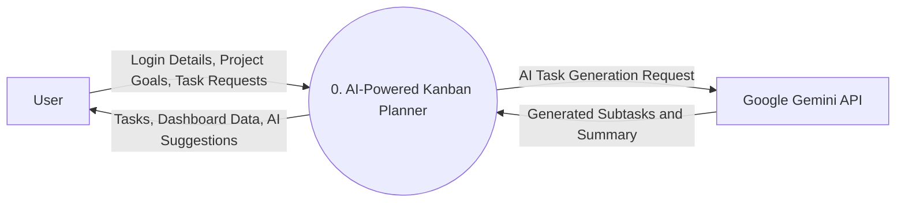

## 2. Data Flow Diagram (DFD)

A Data Flow Diagram (DFD) represents how data enters, moves through, and leaves a system. It helps understand the interaction between external entities and the application.

### 2.1 DFD Level 0 – Context Diagram

DFD Level 0 represents the entire AI-Powered Kanban Planner as a single process. It shows the external entities interacting with the system and the data exchanged between them.

#### 2.1.1 DFD Level 0 Diagram

#### 2.1.2 External Entities

| External Entity | Description |
|---|---|
| User | The person who interacts with the application. |
| Google Gemini API | External AI service used for task generation and completion summaries. |

#### 2.1.3 Main Process

**Process 0: AI-Powered Kanban Planner**

The main process represents the complete application. It receives user requests, processes information, interacts with the Gemini API, and provides responses to the user.

#### 2.1.4 Data Flow Description

| Data Flow | Direction | Description |
|---|---|---|
| Login Details | User → System | User authentication information. |
| Project Goals | User → System | Goals entered by the user. |
| Task Requests | User → System | Requests to create, update, or delete tasks. |
| Tasks | System → User | Task information displayed to the user. |
| Dashboard Data | System → User | Productivity and progress information. |
| AI Task Request | System → Gemini API | Request for AI-based task generation. |
| Generated Subtasks | Gemini API → System | Actionable subtasks generated by AI. |
| Completion Summary | Gemini API → System | AI-generated task completion summary. |

#### 2.1.5 Working Explanation

1. The user submits login details, project goals, or task requests.
2. The AI-Powered Kanban Planner receives and processes the requests.
3. For AI-related operations, the system sends a request to Google Gemini API.
4. Gemini API returns generated subtasks or completion summaries.
5. The system processes and stores the required information.
6. The application displays tasks, AI suggestions, and dashboard information to the user.

#### 2.1.6 Expected Outcome

DFD Level 0 provides a high-level overview of the system, its external entities, and the data exchanged between them.
