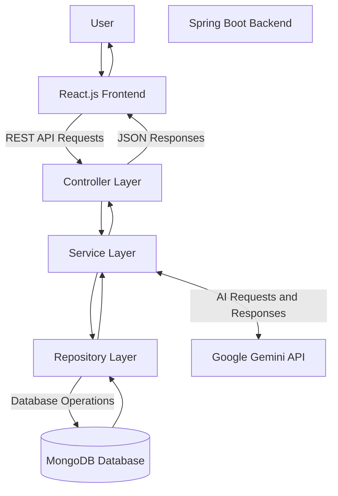
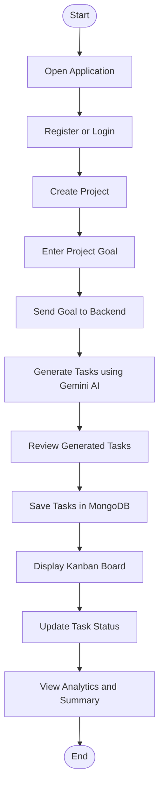
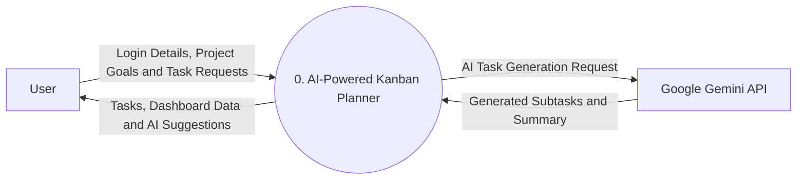
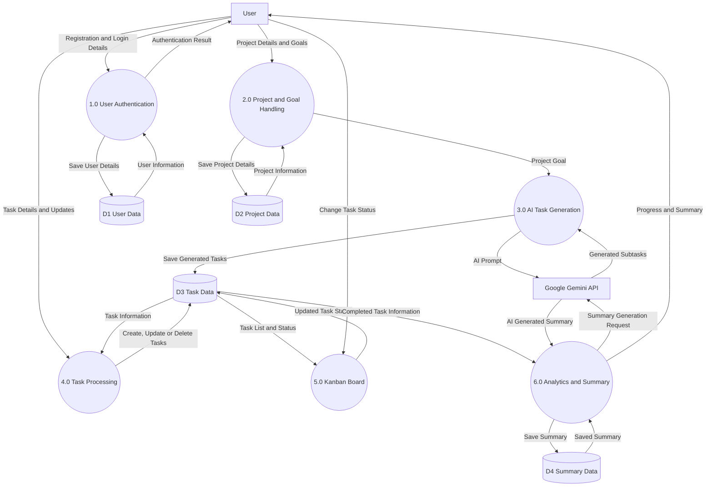
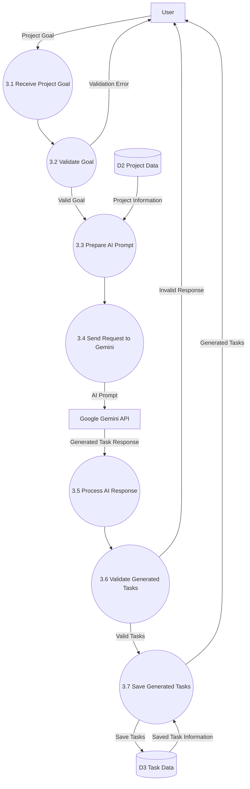
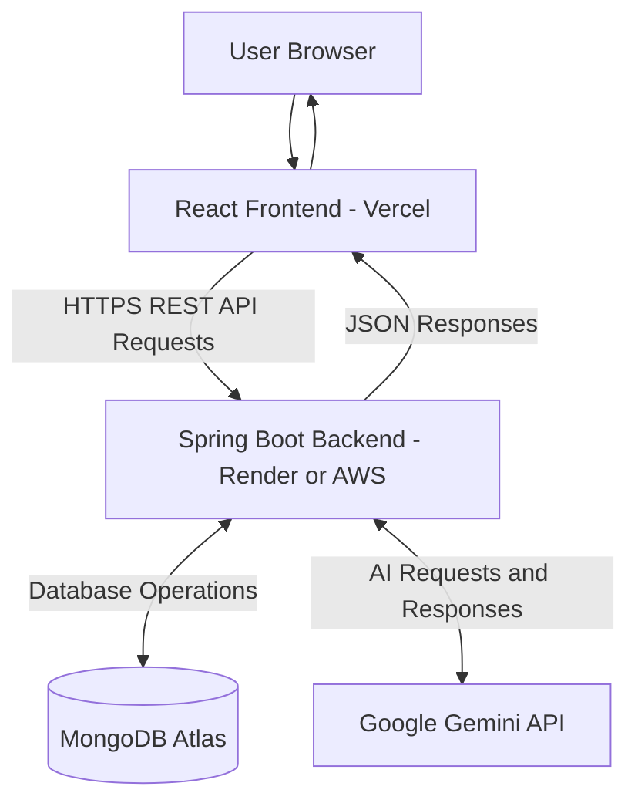

# System Design Document – AI-Powered Kanban Planner

## 1. Introduction

### 1.1 Purpose

This document describes the system architecture, components, data flow, database structure, and technical design of the AI-Powered Kanban Planner.

The purpose of this document is to explain how the application works internally and how its frontend, backend, database, and AI services interact with each other.

### 1.2 Project Overview

The AI-Powered Kanban Planner is an AI-based task planning and productivity application.

It allows users to enter project goals and automatically generate actionable tasks using Google Gemini AI.

Users can organize generated tasks on a Kanban board, track their progress, and view productivity analytics.

### 1.3 Technology Stack

| Layer | Technology |
|---|---|
| Frontend | React.js |
| UI Styling | Tailwind CSS |
| Backend | Java 21, Spring Boot |
| Architecture | Monolithic Architecture with Layered Design |
| Database | MongoDB |
| AI Integration | Google Gemini API |
| Authentication | Spring Security, JWT |
| Drag and Drop | @hello-pangea/dnd |
| Charts | Recharts |
| API Testing | Postman |
| Backend Testing | JUnit 5, Mockito |
| Build Tool | Maven |
| Version Control | Git and GitHub |
| Frontend Deployment | Vercel |
| Backend Deployment | Render / AWS |
| Database Hosting | MongoDB Atlas |

---

## 2. System Architecture

### 2.1 Architecture Overview

The application follows a Client-Server Architecture with a Layered Backend Design.

The frontend is developed using React.js, while the backend is developed using Java and Spring Boot.

MongoDB is used to store user information, projects, tasks, and summaries.

Google Gemini API is integrated to generate tasks and AI-based summaries.

### 2.2 System Architecture Diagram



### 2.3 Component Description

| Component | Responsibility |
|---|---|
| React.js Frontend | Provides the user interface |
| Spring Boot Backend | Handles application logic and API requests |
| Controller Layer | Receives and processes HTTP requests |
| Service Layer | Executes business logic |
| Repository Layer | Communicates with MongoDB |
| MongoDB | Stores application data |
| Gemini API | Generates AI tasks and summaries |

### 2.4 Backend Layered Architecture

The Spring Boot backend follows a layered architecture.

**1. Controller Layer**

- Handles incoming HTTP requests.
- Exposes REST API endpoints.
- Sends requests to the service layer.
- Returns HTTP responses.

**2. Service Layer**

- Contains business logic.
- Handles task creation and updates.
- Communicates with the Gemini API.
- Processes AI-generated responses.

**3. Repository Layer**

- Communicates with MongoDB.
- Performs database operations.
- Uses Spring Data MongoDB repositories.

**4. Model Layer**

- Defines application data structures.
- Represents MongoDB documents.
- Includes entities such as User, Project, and Task.

### 2.5 Architecture Type

The application initially follows a Monolithic Backend Architecture with Layered Design.

All backend modules run within a single Spring Boot application.

The application is organized into separate packages such as Controller, Service, Repository, Model, and Configuration.

This structure makes the application easier to develop, test, and maintain. Individual modules can potentially be separated into microservices in the future if required.

---

## 3. Application Workflow

### 3.1 Main Application Workflow

1. User opens the application.
2. User registers or logs in.
3. User creates a project.
4. User enters a project goal.
5. Frontend sends the goal to the Spring Boot backend.
6. Backend sends a prompt to Google Gemini API.
7. Gemini generates actionable subtasks.
8. Backend processes and returns the generated tasks.
9. User reviews and saves the tasks.
10. Tasks are stored in MongoDB.
11. User manages tasks through the Kanban board.
12. Application displays progress and productivity analytics.

### 3.2 Workflow Diagram



---

## 4. Data Flow Diagram (DFD)

### 4.1 Introduction to DFD

A Data Flow Diagram (DFD) represents how data moves through a system.

It explains how data enters the application, how it is processed, where it is stored, and how information is returned to the user.

This project uses three levels of DFD:

- DFD Level 0 – Context Diagram
- DFD Level 1 – Detailed Process Diagram
- DFD Level 2 – Process-Level Detailed Diagram

### 4.2 DFD Level 0 – Context Diagram

#### 4.2.1 Overview

DFD Level 0 represents the entire AI-Powered Kanban Planner as a single process.

It shows the interaction between the application, the user, and the external Google Gemini API.

#### 4.2.2 Diagram



#### 4.2.3 External Entities

| Entity | Description |
|---|---|
| User | Interacts with the application |
| Google Gemini API | Generates AI-based tasks and summaries |

#### 4.2.4 Main Process

**0. AI-Powered Kanban Planner**

This process represents the complete application.

It receives user input, processes requests, communicates with external AI services, stores information, and returns results.

#### 4.2.5 Data Flow Description

| Data Flow | Description |
|---|---|
| User to System | Login details, project goals, and task requests |
| System to User | Tasks, project information, and analytics |
| System to Gemini | AI task generation prompts |
| Gemini to System | Generated subtasks and summaries |

#### 4.2.6 Expected Outcome

DFD Level 0 provides a high-level understanding of the system and its external interactions.

---

### 4.3 DFD Level 1 – Detailed Process Diagram

#### 4.3.1 Overview

DFD Level 1 expands the main application process into smaller internal processes.

It explains how different modules interact with the user, database, and Gemini API.

#### 4.3.2 DFD Level 1 Diagram



#### 4.3.3 Process Description

| Process | Name | Description |
|---|---|---|
| 1.0 | User Authentication | Handles user registration and login |
| 2.0 | Project and Goal Handling | Creates and stores project details and goals |
| 3.0 | AI Task Generation | Sends goals to Gemini API and receives subtasks |
| 4.0 | Task Processing | Handles task creation, retrieval, updating, and deletion |
| 5.0 | Kanban Board | Displays tasks and updates their workflow status |
| 6.0 | Analytics and Summary | Analyzes progress and generates summaries |

#### 4.3.4 Data Store Description

| Data Store | Name | Stored Information |
|---|---|---|
| D1 | User Data | User registration and authentication information |
| D2 | Project Data | Project names, descriptions, and goals |
| D3 | Task Data | Task titles, descriptions, statuses, and timestamps |
| D4 | Summary Data | AI-generated summaries and progress information |

#### 4.3.5 External Entities

**User**

The user registers, logs in, creates projects, generates AI tasks, updates task statuses, and views analytics.

**Google Gemini API**

Gemini API receives prompts from the backend and returns generated subtasks or summaries.

#### 4.3.6 Data Flow Description

1. User provides registration or login details.
2. Authentication process validates the user.
3. User creates a project and enters a goal.
4. The AI Task Generation process sends the goal to Gemini API.
5. Gemini API returns suggested subtasks.
6. Generated tasks are stored in the Task Data store.
7. User creates, updates, or deletes tasks.
8. The Kanban Board displays tasks and updates their workflow status.
9. Completed task information is processed for analytics and summaries.
10. Generated summaries are stored and displayed to the user.

#### 4.3.7 Expected Outcome

DFD Level 1 explains the major internal processes, data stores, external entities, and data flows of the application.

---

### 4.4 DFD Level 2 – AI Task Generation Process

#### 4.4.1 Overview

DFD Level 2 provides a more detailed representation of a selected process from DFD Level 1.

In this project, Process 3.0 – AI Task Generation is expanded into smaller sub-processes.

It explains how a project goal is validated, sent to Gemini API, processed, and converted into actionable tasks.

#### 4.4.2 DFD Level 2 Diagram



#### 4.4.3 Sub-Process Description

| Process | Name | Description |
|---|---|---|
| 3.1 | Receive Project Goal | Receives the project goal from the user |
| 3.2 | Validate Goal | Checks whether the goal is valid and not empty |
| 3.3 | Prepare AI Prompt | Creates a structured prompt for Gemini |
| 3.4 | Send Request to Gemini | Sends the prompt to the external AI service |
| 3.5 | Process AI Response | Reads and processes the AI response |
| 3.6 | Validate Generated Tasks | Checks the generated task data |
| 3.7 | Save Generated Tasks | Stores approved tasks in MongoDB |

#### 4.4.4 Detailed Working Explanation

**Step 1: Receive Project Goal**

The user enters a project goal through the React frontend.

Example:

"Build an E-commerce Website."

**Step 2: Validate Goal**

The backend checks whether the goal is empty or invalid.

If the goal is invalid, the backend returns an appropriate validation error.

**Step 3: Prepare AI Prompt**

The backend prepares a structured prompt containing the project goal and task-generation instructions.

**Step 4: Send Request to Gemini**

The Spring Boot service sends the prompt to Google Gemini API.

**Step 5: Process AI Response**

Gemini returns suggested tasks. The backend processes the response into the application's expected format.

**Step 6: Validate Generated Tasks**

The backend checks the generated task titles and descriptions before saving them.

**Step 7: Save Generated Tasks**

The approved tasks are saved in MongoDB and returned to the frontend.

#### 4.4.5 Expected Outcome

DFD Level 2 explains the internal working of the AI Task Generation module in detail.

---

## 5. Database Design

### 5.1 Database Overview

MongoDB is used as the primary database for the AI-Powered Kanban Planner.

It stores user information, project details, tasks, and AI-generated summaries.

The database uses collections to organize application data.

### 5.2 Proposed Database Collections

| Collection | Purpose |
|---|---|
| users | Stores user account information |
| projects | Stores project details and goals |
| tasks | Stores generated and manually created tasks |
| summaries | Stores AI-generated summaries |

### 5.3 User Collection

Example document:

```json
{
  "_id": "USER_ID",
  "name": "John",
  "email": "john@example.com",
  "password": "HASHED_PASSWORD",
  "role": "USER",
  "createdAt": "2026-11-02T10:00:00"
}
```

### 5.4 Project Collection

Example document:

```json
{
  "_id": "PROJECT_ID",
  "userId": "USER_ID",
  "projectName": "E-commerce Website",
  "goal": "Build an E-commerce Website",
  "description": "Develop an online shopping platform",
  "createdAt": "2026-11-02T10:00:00"
}
```

### 5.5 Task Collection

Example document:

```json
{
  "_id": "TASK_ID",
  "projectId": "PROJECT_ID",
  "title": "Create Login Page",
  "description": "Develop the user login interface",
  "status": "TODO",
  "priority": "HIGH",
  "createdAt": "2026-11-02T10:00:00"
}
```

### 5.6 Summary Collection

Example document:

```json
{
  "_id": "SUMMARY_ID",
  "projectId": "PROJECT_ID",
  "content": "The project has completed its initial tasks.",
  "createdAt": "2026-11-02T10:00:00"
}
```

### 5.7 Database Relationships

The application uses reference fields to connect related MongoDB documents.

- One user can create multiple projects.
- One project can contain multiple tasks.
- One project can have multiple summaries.
- Each task belongs to a project.

---

## 6. API Design

### 6.1 API Overview

The backend exposes REST APIs that allow the React frontend to communicate with the Spring Boot application.

The APIs exchange data in JSON format.

### 6.2 Proposed API Endpoints

| HTTP Method | Endpoint | Description |
|---|---|---|
| POST | /api/auth/register | Register a new user |
| POST | /api/auth/login | Authenticate a user |
| POST | /api/projects | Create a project |
| GET | /api/projects | Retrieve projects |
| GET | /api/projects/{id} | Retrieve project by ID |
| PUT | /api/projects/{id} | Update project |
| DELETE | /api/projects/{id} | Delete project |
| POST | /api/ai/generate-tasks | Generate tasks using AI |
| POST | /api/tasks | Create a task |
| GET | /api/tasks | Retrieve all tasks |
| GET | /api/tasks/{id} | Retrieve task by ID |
| PUT | /api/tasks/{id} | Update task |
| DELETE | /api/tasks/{id} | Delete task |
| GET | /api/analytics/{projectId} | Retrieve project analytics |
| POST | /api/ai/generate-summary | Generate AI summary |

Note: These are planned API endpoints. The implemented Task CRUD endpoints are the initial backend APIs.

### 6.3 API Communication Flow

1. React frontend sends an HTTP request.
2. Spring Boot Controller receives the request.
3. Service layer executes business logic.
4. Repository layer accesses MongoDB when required.
5. Backend returns a JSON response.
6. React frontend displays the result.

---

## 7. Security Design

### 7.1 Authentication

Spring Security and JWT are planned for user authentication.

Users will log in using their registered credentials.

After successful authentication, the backend will issue a JWT token.

### 7.2 Authorization

Protected APIs will verify the JWT token before allowing access.

Users should only be able to access their own projects and tasks.

### 7.3 Password Security

Passwords must be stored as secure password hashes.

Plain-text passwords must never be stored in the database.

### 7.4 API Security

- Validate incoming request data.
- Use HTTPS in production.
- Keep API keys in environment variables.
- Do not expose Gemini API keys in the frontend.
- Handle unauthorized and invalid requests safely.

---

## 8. Error Handling

The application should handle errors in a consistent manner.

| Error Scenario | Expected Handling |
|---|---|
| Empty task title | Return HTTP 400 Bad Request |
| Invalid request data | Return validation error |
| Task not found | Return HTTP 404 Not Found |
| Unauthorized request | Return HTTP 401 Unauthorized |
| Forbidden operation | Return HTTP 403 Forbidden |
| Gemini API failure | Return a controlled AI service error |
| Database failure | Return an appropriate server error |

A centralized exception-handling mechanism using Spring Boot `@RestControllerAdvice` will be used to manage backend exceptions.

---

## 9. Multithreading and Asynchronous Processing

### 9.1 Overview

The initial application follows a monolithic architecture.

Asynchronous processing can be introduced for operations that should run in the background.

### 9.2 Planned Use Cases

- Background AI task generation.
- Sending email notifications.
- Generating project summaries.
- Other time-consuming background operations.

### 9.3 Expected Benefits

- Improves request handling.
- Prevents unnecessary waiting for background operations.
- Helps separate long-running tasks from normal API processing.

Asynchronous processing will be introduced where required using Spring's asynchronous execution capabilities.

---

## 10. Deployment Architecture

### 10.1 Deployment Overview

The application is planned to be deployed using cloud-based services.

- React frontend: Vercel
- Spring Boot backend: Render or AWS
- MongoDB database: MongoDB Atlas
- AI service: Google Gemini API

### 10.2 Deployment Diagram



### 10.3 Deployment Benefits

- Frontend and backend can be deployed independently.
- MongoDB Atlas provides a hosted database.
- Cloud deployment makes the application accessible over the internet.
- Environment variables can be used to manage sensitive configuration.

---

## 11. Future Enhancements

The following features may be introduced in future versions:

1. Advanced AI-based task prioritization.
2. Smart deadline recommendations.
3. Team collaboration.
4. Real-time notifications.
5. Advanced productivity analytics.
6. Sprint planning and tracking.
7. AI-based project risk identification.
8. Microservices architecture if future scaling requires it.

---

## 12. Conclusion

The AI-Powered Kanban Planner uses a modern client-server architecture with a layered Spring Boot backend.

React.js provides the frontend interface, Java Spring Boot handles backend operations, and MongoDB stores application data.

Google Gemini API provides AI-based task generation and summary capabilities.

The system design documents the overall architecture, application workflow, data flow diagrams, database structure, API design, security, error handling, asynchronous processing, and deployment approach.

This design provides a foundation for implementing, testing, maintaining, and extending the application in future versions.

---

**Document Status:** System Design – Complete

**Project:** AI-Powered Kanban Planner

**Version:** 1.0

**Last Updated:** 02 November 2026
