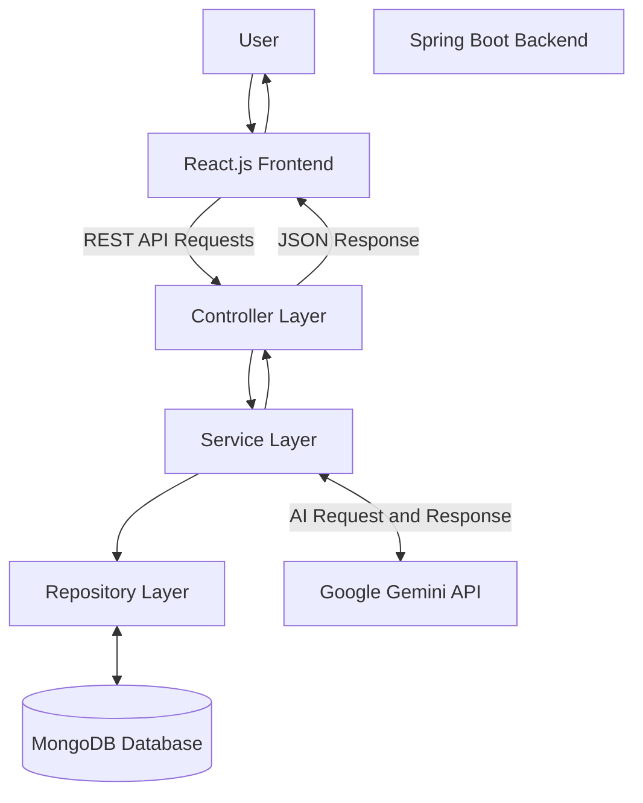
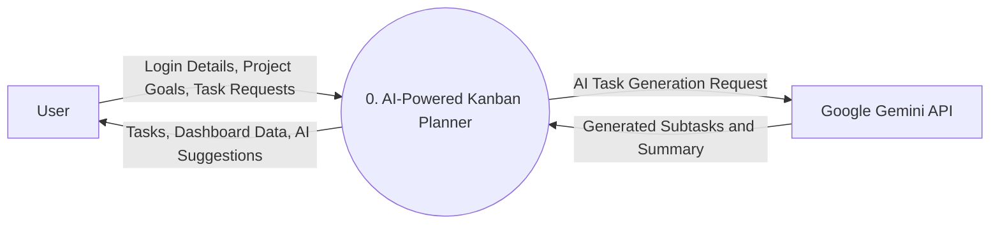
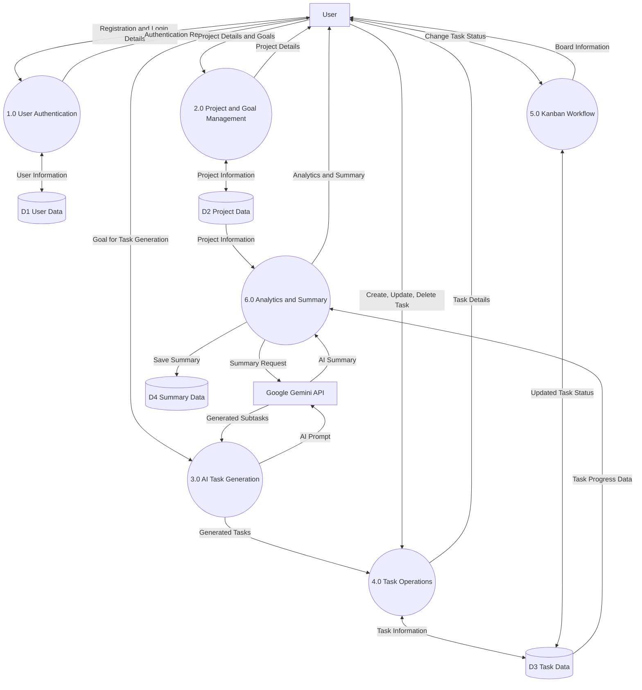
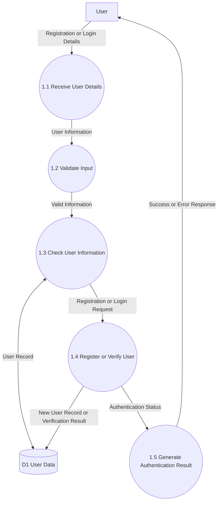
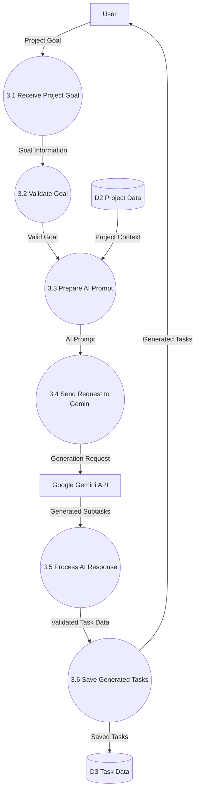
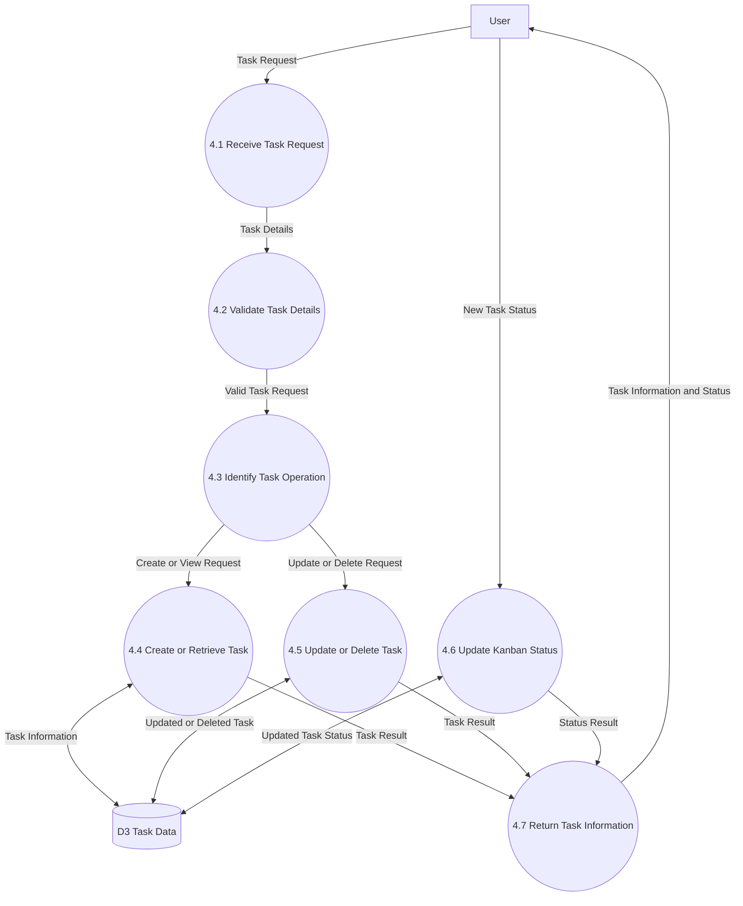

# System Design – AI-Powered Kanban Planner

## 1. System Architecture

### 1.1 Introduction

The AI-Powered Kanban Planner is a web-based application designed to help users plan projects, organize tasks, track progress, and improve productivity using Artificial Intelligence.

The system uses React.js for the frontend, Java Spring Boot for the backend, MongoDB for database storage, and Google Gemini API for AI-powered task generation and summaries.

The application initially follows a Monolithic Backend Architecture with a layered design.

### 1.2 Architecture Diagram

### 1.3 Component Description

| Component | Responsibility |
|---|---|
| React.js | Provides the user interface and Kanban board. |
| Tailwind CSS | Provides responsive styling and UI design. |
| Spring Boot | Handles backend operations and business logic. |
| Controller Layer | Receives and processes HTTP requests. |
| Service Layer | Executes application business logic. |
| Repository Layer | Communicates with MongoDB. |
| MongoDB | Stores users, projects, tasks, and related information. |
| Gemini API | Generates AI-based tasks and summaries. |

### 1.4 Application Workflow

1. The user interacts with the React.js frontend.
2. The frontend sends HTTP requests to the Spring Boot backend.
3. The Controller receives and processes incoming requests.
4. The Service Layer executes the required business logic.
5. The Repository Layer communicates with MongoDB when database operations are required.
6. For AI-related operations, the Service Layer communicates with the Google Gemini API.
7. Gemini generates actionable subtasks or summaries.
8. The backend sends the response to the frontend in JSON format.
9. The frontend displays the results to the user.

### 1.5 Architecture Type

The application initially follows a **Monolithic Backend Architecture with Layered Design**.

The backend is developed as a single Spring Boot application with separate logical layers:

- Controller Layer
- Service Layer
- Repository Layer
- Model Layer
- Configuration Layer

This structure makes the application easier to develop, test, maintain, and extend.

In the future, individual modules can be separated into independent services if required.

---

## 2. Data Flow Diagram (DFD)

### 2.1 Introduction

A Data Flow Diagram (DFD) represents how data moves through a system.

It illustrates the interaction between external entities, system processes, and data stores.

The DFD helps understand how information enters the application, how it is processed, and where it is stored.

The AI-Powered Kanban Planner uses three levels of DFD:

- DFD Level 0 – Context Diagram
- DFD Level 1 – Detailed Process Diagram
- DFD Level 2 – Detailed Process Breakdown

### 2.2 DFD Level 0 – Context Diagram

#### 2.2.1 Overview

DFD Level 0 represents the entire AI-Powered Kanban Planner as a single process.

It shows the interaction between the user, the application, and the external Google Gemini API.

#### 2.2.2 Diagram

#### 2.2.3 External Entities

| Entity | Description |
|---|---|
| User | Interacts with the application to create projects, generate tasks, and track progress. |
| Google Gemini API | External AI service that generates subtasks and summaries based on user input. |

#### 2.2.4 Main Process

**Process 0: AI-Powered Kanban Planner**

The main process represents the complete application. It receives user requests, processes information, communicates with the database and AI service, and returns the required results.

#### 2.2.5 Data Flow Description

| Data Flow | Description |
|---|---|
| Login Details | User sends authentication information to the application. |
| Project Goals | User submits project goals for planning. |
| Task Requests | User requests task creation or updates. |
| AI Generation Request | Application sends a prompt to Gemini API. |
| Generated Subtasks | Gemini returns AI-generated tasks. |
| Dashboard Data | Application returns project and task progress information. |
| AI Suggestions | Application displays AI-generated suggestions and summaries. |

#### 2.2.6 Working Explanation

1. The user sends login details, project goals, or task requests to the application.
2. The application processes the received information.
3. The application sends AI-related requests to Google Gemini API.
4. Gemini API generates subtasks or summaries.
5. The application processes and stores the required information.
6. The final results are returned to the user.

#### 2.2.7 Expected Outcome

DFD Level 0 provides a high-level understanding of the application and its interaction with external entities.

---

### 2.3 DFD Level 1 – Detailed Process Diagram

#### 2.3.1 Overview

DFD Level 1 expands the main application process from DFD Level 0 into multiple smaller processes.

It explains how the system handles authentication, project creation, AI task generation, task operations, Kanban workflow, and productivity analytics.

It also represents the major data stores used by the application.

#### 2.3.2 DFD Level 1 Diagram

#### 2.3.3 Process Description

| Process ID | Process Name | Description |
|---|---|---|
| 1.0 | User Authentication | Handles user registration and login. |
| 2.0 | Project and Goal Management | Allows users to create and organize project goals. |
| 3.0 | AI Task Generation | Communicates with Gemini API to generate actionable subtasks. |
| 4.0 | Task Operations | Handles task creation, retrieval, updating, and deletion. |
| 5.0 | Kanban Workflow | Manages task status changes across board columns. |
| 6.0 | Analytics and Summary | Calculates productivity information and generates summaries. |

#### 2.3.4 Data Store Description

| Data Store | Name | Description |
|---|---|---|
| D1 | User Data | Stores user registration and authentication information. |
| D2 | Project Data | Stores project details and goals. |
| D3 | Task Data | Stores task titles, descriptions, status, and timestamps. |
| D4 | Summary Data | Stores generated summaries and productivity information. |

#### 2.3.5 External Entity Description

**1. User**

The user interacts with the application to:

- Register and log in.
- Create projects and goals.
- Generate tasks using AI.
- Create, update, and delete tasks.
- Move tasks between Kanban columns.
- View productivity analytics and summaries.

**2. Google Gemini API**

Google Gemini API is an external AI service used to:

- Analyze project goals.
- Generate logical subtasks.
- Generate task completion summaries.
- Provide AI-based suggestions.

#### 2.3.6 Data Flow Description

| Source | Destination | Data |
|---|---|---|
| User | User Authentication | Registration and login details |
| User Authentication | User Data | User information |
| User | Project and Goal Management | Project details and goals |
| Project and Goal Management | Project Data | Project information |
| User | AI Task Generation | Project goal |
| AI Task Generation | Gemini API | AI generation prompt |
| Gemini API | AI Task Generation | Generated subtasks |
| Task Operations | Task Data | Task information |
| Kanban Workflow | Task Data | Updated task status |
| Project Data | Analytics and Summary | Project information |
| Task Data | Analytics and Summary | Task progress information |
| Analytics and Summary | Summary Data | Generated summary |
| Analytics and Summary | User | Analytics and summary results |

#### 2.3.7 Working Explanation

1. The user registers or logs in through the authentication process.
2. The application processes authentication information and accesses user data.
3. The user creates a project and enters a project goal.
4. The AI Task Generation process sends the goal to Gemini API.
5. Gemini API returns logically organized subtasks.
6. The user can save the generated tasks in the application.
7. Task Operations handles task creation, retrieval, updating, and deletion.
8. The Kanban Workflow process updates task status when users move tasks between columns.
9. Analytics and Summary processes use project and task information to calculate progress.
10. The application can request an AI-generated summary and store the result.
11. The final dashboard information is displayed to the user.

#### 2.3.8 Expected Outcome

DFD Level 1 provides a detailed understanding of the internal processes, data stores, and information flow within the AI-Powered Kanban Planner.

---

### 2.4 DFD Level 2 – Detailed Process Breakdown

#### 2.4.1 Introduction

DFD Level 2 provides a more detailed representation of the internal processes of the application.

It breaks down the major processes identified in DFD Level 1 into smaller sub-processes to explain how data is received, validated, processed, stored, and returned to the user.

For the AI-Powered Kanban Planner, DFD Level 2 focuses on the following major processes:

1. User Authentication
2. AI Task Generation
3. Task Operations and Kanban Workflow

### 2.4.2 DFD Level 2 – User Authentication

#### A. Overview

The User Authentication process handles user registration and login.

It validates the information provided by the user, communicates with the User Data store, and returns the authentication result.

#### B. Diagram

#### C. Sub-process Description

| Process ID | Process Name | Description |
|---|---|---|
| 1.1 | Receive User Details | Receives registration or login information from the user. |
| 1.2 | Validate Input | Checks whether the required fields are provided and valid. |
| 1.3 | Check User Information | Checks the user record in the database. |
| 1.4 | Register or Verify User | Creates a new user record or verifies login credentials. |
| 1.5 | Generate Authentication Result | Returns the authentication result to the user. |

#### D. Data Flow Explanation

1. The user enters registration or login details.
2. The application receives the submitted information.
3. The system validates the required fields.
4. The application checks the User Data store.
5. For registration, a new user record is created after successful validation.
6. For login, the submitted credentials are verified against the stored credentials.
7. The application returns an appropriate success or error response.

#### E. Data Store

**D1 – User Data**

Stores user-related information such as:

- User ID
- Name
- Email
- Hashed Password
- Account Creation Date

Passwords must be stored securely using password hashing rather than plain text.

#### F. Expected Outcome

The authentication process allows registered users to access the application securely and prevents invalid registration or login requests.

---

### 2.4.3 DFD Level 2 – AI Task Generation

#### A. Overview

The AI Task Generation process allows users to enter a project goal and receive logically organized subtasks generated by Google Gemini API.

The system validates the goal, prepares an AI prompt, sends it to Gemini API, processes the generated response, and saves the approved tasks.

#### B. Diagram

#### C. Sub-process Description

| Process ID | Process Name | Description |
|---|---|---|
| 3.1 | Receive Project Goal | Receives the project goal entered by the user. |
| 3.2 | Validate Goal | Checks whether the goal is present and meets input requirements. |
| 3.3 | Prepare AI Prompt | Prepares a structured prompt using the project goal and relevant context. |
| 3.4 | Send Request to Gemini | Sends the prompt to Google Gemini API. |
| 3.5 | Process AI Response | Processes and validates the generated subtasks. |
| 3.6 | Save Generated Tasks | Saves the approved generated tasks in MongoDB. |

#### D. Data Flow Explanation

1. The user enters a project goal.
2. The application receives the goal.
3. The system validates the submitted goal.
4. The application retrieves relevant project information when required.
5. The Service Layer prepares a structured AI prompt.
6. The prompt is sent to Google Gemini API.
7. Gemini API generates actionable subtasks.
8. The application processes and validates the AI response.
9. The generated tasks are saved in the Task Data store.
10. The generated tasks are returned to the user for review.

#### E. Data Stores

**D2 – Project Data**

Stores project-related information such as:

- Project ID
- Project Name
- Project Description
- Project Goal
- Creation Date

**D3 – Task Data**

Stores generated and manually created tasks such as:

- Task ID
- Project ID
- Task Title
- Task Description
- Task Status
- Creation Date

#### F. Error Handling

The application should handle the following situations:

- Empty project goal.
- Invalid user input.
- Gemini API request failure.
- Gemini API timeout.
- Invalid or incomplete AI response.
- Database saving failure.

#### G. Expected Outcome

The AI Task Generation process converts project goals into actionable subtasks and stores the approved tasks in the application.

---

### 2.4.4 DFD Level 2 – Task Operations and Kanban Workflow

#### A. Overview

The Task Operations and Kanban Workflow process allows users to create, view, update, delete, and organize tasks.

It also handles task status changes when users move tasks between Kanban columns.

The application uses four main Kanban columns:

- To-Do
- In Progress
- Review
- Done

#### B. Diagram

#### C. Sub-process Description

| Process ID | Process Name | Description |
|---|---|---|
| 4.1 | Receive Task Request | Receives task-related requests from the user. |
| 4.2 | Validate Task Details | Validates task information before processing. |
| 4.3 | Identify Task Operation | Identifies whether the user wants to create, view, update, or delete a task. |
| 4.4 | Create or Retrieve Task | Creates a new task or retrieves existing task information. |
| 4.5 | Update or Delete Task | Updates task details or deletes the selected task. |
| 4.6 | Update Kanban Status | Updates the task status when the user moves a task between board columns. |
| 4.7 | Return Task Information | Returns the operation result to the user. |

#### D. Data Flow Explanation

1. The user submits a task-related request.
2. The application receives the task details.
3. The system validates the submitted information.
4. The application identifies the requested operation.
5. The Task Data store is accessed to create, retrieve, update, or delete the task.
6. When a user moves a task between Kanban columns, the task status is updated.
7. The application returns the updated task information to the user.
8. The Kanban board displays the latest task status.

#### E. Data Store

**D3 – Task Data**

Stores task-related information such as:

- Task ID
- Project ID
- Task Title
- Description
- Status
- Created At
- Updated At

#### F. Kanban Workflow

| Kanban Column | Description |
|---|---|
| To-Do | Tasks that are planned but not yet started. |
| In Progress | Tasks currently being worked on. |
| Review | Tasks waiting for review or verification. |
| Done | Tasks that have been completed. |

#### G. Expected Outcome

The Task Operations and Kanban Workflow process provides an organized way to manage tasks, update their status, and track project progress.

---

### 2.4.5 Summary of DFD Level 2

| Process | Main Function | Related Data Store |
|---|---|---|
| User Authentication | Registration and Login | D1 – User Data |
| AI Task Generation | Generate AI-based subtasks | D2 – Project Data, D3 – Task Data |
| Task Operations and Kanban Workflow | Create, retrieve, update, delete, and move tasks | D3 – Task Data |

### 2.4.6 Conclusion

DFD Level 2 provides a detailed understanding of the internal working of the AI-Powered Kanban Planner.

It explains how user authentication, AI task generation, and task operations are divided into smaller processes.

These diagrams help developers understand the data flow and interactions between users, application processes, external AI services, and database stores.

The detailed DFD design provides a foundation for backend implementation, API development, and software testing.

---

## 3. Design Considerations

### 3.1 Scalability

The application uses a modular backend structure so that additional features can be introduced without significantly changing the existing architecture.

### 3.2 Maintainability

Separate Controller, Service, Repository, and Model layers help keep the backend organized and easier to maintain.

### 3.3 Security

Authentication and authorization will be implemented using Spring Security and JWT.

Sensitive configuration values, including API keys, will be stored outside the source code.

### 3.4 Performance

Database operations will be handled through Spring Data MongoDB.

Background processing may be introduced for time-consuming operations such as AI generation and notifications.

### 3.5 Reliability

The application will include input validation, exception handling, and appropriate API error responses to improve reliability.

---

## 4. Future Design Enhancements

The following enhancements are planned for future development:

1. JWT-based authentication and authorization.
2. AI-powered task generation using Google Gemini API.
3. Drag-and-drop Kanban board.
4. Productivity charts and sprint analytics.
5. Background task processing using asynchronous execution.
6. Deployment using cloud-based services.

---

## 5. Conclusion

The system design defines the architecture, major components, and data flow of the AI-Powered Kanban Planner.

The application follows a layered Spring Boot backend architecture with React.js as the frontend and MongoDB as the database.

Google Gemini API provides AI-powered task generation and summary capabilities.

This design provides a foundation for implementing, testing, and extending the application in future development phases.

---

**End of Document**
