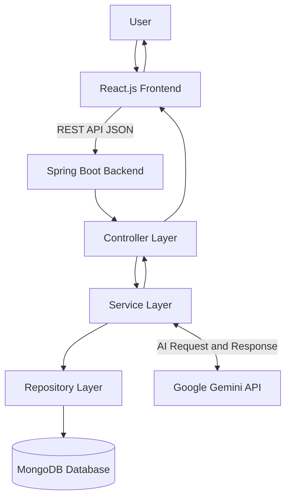

# System Design – AI-Powered Kanban Planner

## 1. System Architecture

The application follows a frontend-backend architecture with a layered Spring Boot backend.

### 1.1 Architecture Diagram

### 1.2 Component Description

| Component | Responsibility |
|---|---|
| React.js | User interface and Kanban board |
| Spring Boot | Backend processing |
| Controller | Handles HTTP requests |
| Service | Executes business logic |
| Repository | Performs database operations |
| MongoDB | Stores application data |
| Gemini API | Generates AI tasks and summaries |

### 1.3 Application Workflow

1. User enters a project goal in the React frontend.
2. Frontend sends a request to the Spring Boot API.
3. Controller receives the request.
4. Service communicates with Gemini API.
5. Gemini generates actionable subtasks.
6. Backend returns the response to the frontend.
7. User reviews and saves the tasks.
8. MongoDB stores the tasks.

### 1.4 Architecture Type

The application initially follows a Monolithic Backend Architecture with Layered Design.

The backend contains Controller, Service, and Repository layers within a single Spring Boot application.
